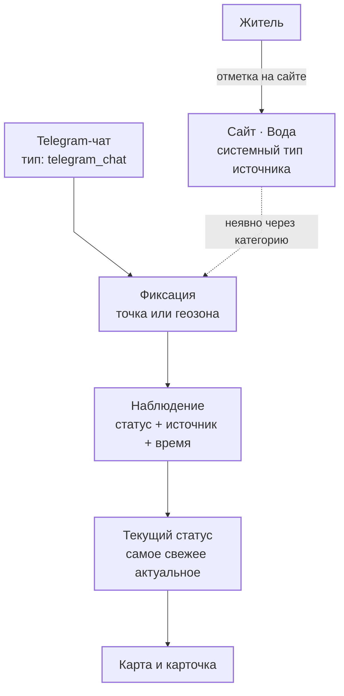

[← Быстрый старт](01-getting-started.md) · [Далее: Источники данных →](03-sources.md)

# 02. Первый сценарий: настройка с нуля

> Настройка идёт четырьмя этапами. Каждый следующий опирается на предыдущий:
> без секретов не заработает источник, без источника нечего привязывать к фиксации,
> без фиксации нечего показывать на карте.

## Общая схема

Что важно:

- источники и фиксации — разные сущности;
- к одной фиксации можно привязать несколько источников;
- источники бывают разных типов: Telegram, MAX, системный «Сайт»
  (MAX-тип есть в модели, но сбора для него пока нет);
- у каждого источника свои статусы;
- «Сайт» не привязывается вручную — доступен через категорию;
- житель ставит отметку через «Сайт», и она становится наблюдением;
- спорные сообщения из Telegram сначала идут в модерацию, а не на карту;
- на карте показывается текущий статус, вычисленный из наблюдений.

Сплошная линия — явная привязка, пунктир — неявная связь.

## Этап 1. Настройки: LLM, Telegram-бот, прокси

**Кто:** администратор. **Где:** раздел «Секреты», доступен только администратору.

| Что задать | Зачем |
|---|---|
| **Токен Telegram-бота** | бот читает сообщения из чата источника |
| **LLM: ключ, base URL, модель** | LLM разбирает текст сообщения и определяет статус |
| **Прокси** (необязательно) | если задан, Telegram и LLM работают только через него |

Порядок:

1. Создайте бота у `@BotFather`, скопируйте токен.
2. Добавьте бота в чат, который будет источником.
3. Загрузите токен в разделе «Telegram-бот».
4. Заполните LLM: ключ, адрес провайдера, модель.
5. При необходимости добавьте прокси и назначьте его боту/LLM.

Проверка: секреты сохранены, значения больше не показываются. Прямое соединение при
заданном прокси запрещено.

> Без этого этапа источник не сможет ни подключиться к Telegram, ни разобрать сообщения.

## Этап 2. Источник данных

**Кто:** модератор. **Где:** `Источники → Создать источник`.

Источник описывает, **откуда** приходят статусы и **какие статусы** он может сообщать.

| Настройка | Смысл |
|---|---|
| Тип: Telegram-чат | сообщения читает бот |
| Идентификатор чата | `@username`, ID или ссылка |
| Таймаут актуальности | сколько живёт наблюдение |
| Промпт-фильтр | что искать в сообщениях |
| Режим «по тексту» | искать конкретное место или применять статус ко всем привязанным |
| Порог уверенности | ниже порога — сообщение уйдёт в модерацию |
| Статусы источника | например «Вода есть», «Воды нет» |

Важно:

- сервер создаёт источник **без статусов** — добавьте их в карточке источника после создания;
- статусы можно завести вручную или скопировать из справочника; если нужен импорт,
  заранее создайте категорию и статусы в [Каталоге](05-catalog.md);
- статусы источника — это то, что LLM имеет право вернуть; чужие статусы уходят в модерацию;
- после создания назначьте источнику Telegram-бота и прокси: раздел «Секреты» →
  «Подключение источника»;
- источник должен быть включён.

Проверка: в карточке источника состояние «Работает» или «Нет сообщений», а не «Ошибка
авторизации».

## Этап 3. Фиксация на карте

**Кто:** модератор. **Где:** `Фиксации на карте → Создать фиксацию`.

Фиксация — это **где** показывать статус: конкретная точка или геозона.

| Поле | Смысл |
|---|---|
| Название | как место называется на карте |
| Вид: точка или геозона | что рисуем |
| Геометрия | координаты или вершины полигона |
| Тип объекта | определяет категорию и атрибуты |
| Группа | необязательно, для фильтра карты |
| Источники | какие источники могут обновлять эту фиксацию |

Порядок:

1. Убедитесь, что в [Каталоге](05-catalog.md) есть категория и тип объекта.
2. Создайте фиксацию, задайте геометрию и тип.
3. Привяжите к ней источник из этапа 2.
4. Сохраните и проверьте, что объект появился на карте.

Проверка: фиксация активна, видна на карте, в карточке есть привязанный источник.

> Тип обязателен для ручных отметок: через него фиксация получает категорию и системный «Сайт».

## Этап 4. Мониторинг и данные с сайта

**Кто:** все смотрят карту, пользователи ставят отметки.

Теперь работают оба канала:

1. **Telegram** — Worker читает чат, LLM определяет статус, API создаёт наблюдение.
2. **Сайт** — пользователь открывает карточку фиксации и ставит статус вручную.
   Источник «Сайт» подставляется автоматически, выбирать его не нужно.

Что происходит дальше:

- каждое действие создаёт **наблюдение**;
- из наблюдений вычисляется **текущий статус** — побеждает самое свежее актуальное;
- на карте меняется цвет, иконка и подпись;
- спорные сообщения и жалобы попадают в [Модерацию](06-moderation.md);
- модератор может отозвать ошибочное наблюдение.

Проверка: статус из чата появляется на карте, ручная отметка его меняет, жалоба видна в очереди.

## Что от чего зависит

| Если пропустить | Что будет |
|---|---|
| Нет Telegram-бота | источник не подключится, чат не читается |
| Нет LLM | сообщения не разбираются и уходят в ошибки/модерацию |
| Нет статусов источника | LLM нечего возвращать, отметить фиксацию нечем |
| Нет привязки источника | чат не обновляет фиксацию |
| Нет типа у фиксации | нельзя поставить ручную отметку через «Сайт» |
| Нет фиксации | на карте нечего показывать |

## Роли

| Этап | Кто выполняет |
|---|---|
| 1. Секреты | только админ |
| 2. Источник | модератор; подключение бота — админ |
| 3. Фиксация | модератор |
| 4. Карта и отметки | все; модерация — модератор |

Дальше: подробности по каждому шагу — в [Источниках](03-sources.md),
[Фиксациях](04-map-objects.md), [Каталоге](05-catalog.md) и карте.

[← Быстрый старт](01-getting-started.md) · [Далее: Источники данных →](03-sources.md)
